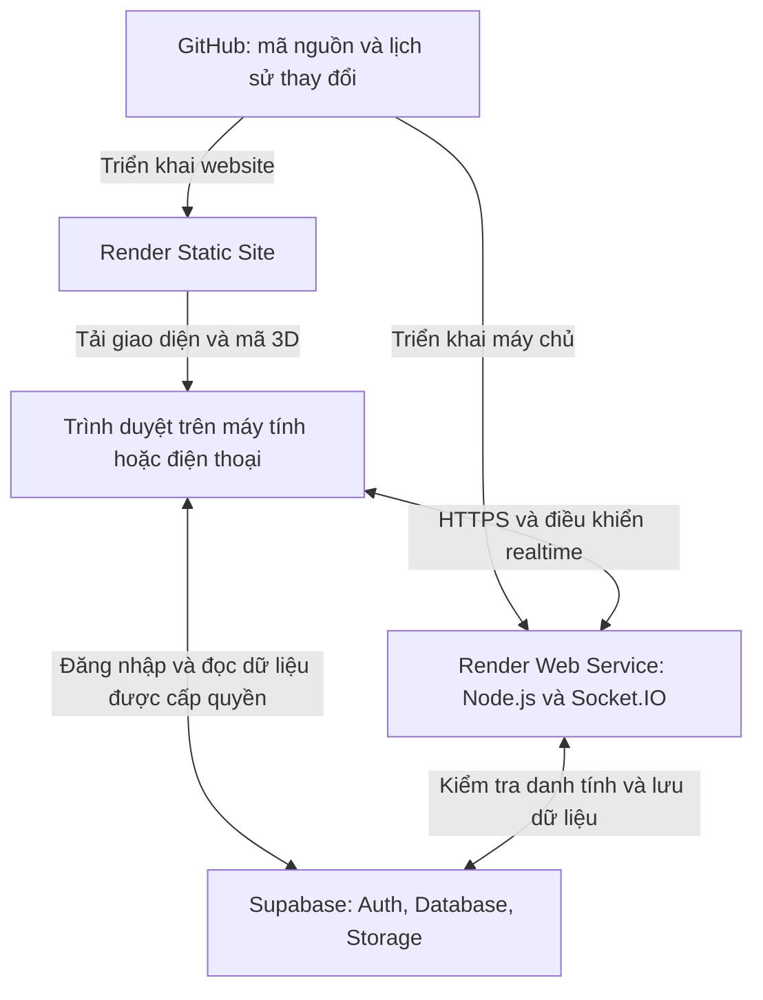

# TLINHGAME — BƯỚC 1: THIẾT KẾ KIẾN TRÚC VÀ CẤU TRÚC DỰ ÁN

Phiên bản thiết kế: 0.1 — ngày 30/10/2026.

**Trạng thái: đề xuất thiết kế để bạn kiểm tra. Chưa viết mã ứng dụng, chưa tạo dịch vụ GitHub/Supabase/Render, chưa triển khai và chưa kiểm thử game.** Những đường dẫn trong tài liệu là vị trí dự kiến của mã nguồn ở Bước 2. Đây không phải thông báo một sản phẩm đã hoàn thành.

## 1. Các quyết định chính

TlinhGame là một nền tảng chung có tài khoản, nhân vật, sảnh, ghép trận và phần thưởng. Mỗi trò chơi là một mô-đun có luật, mô phỏng máy chủ, bản đồ, điều khiển, hình ảnh và âm thanh riêng.

Đề xuất dùng một repository GitHub, hai dịch vụ Render và một dự án Supabase. Website tải từ Render Static Site; máy chủ Node.js chạy trên Render Web Service. Supabase quản lý đăng nhập, cơ sở dữ liệu và tệp lâu dài. Không dùng cơ sở dữ liệu để ghi vị trí người chơi liên tục.

Đề xuất hoàn thiện hai trò chơi đầu tiên theo thứ tự **Ice Arena**, sau đó **Kart Racing**. Cả hai phải có người thật điều khiển và thi đấu qua Internet. Các trò chơi khác được phát triển theo từng đợt; chỉ xuất hiện nút “Chơi” khi đã triển khai và kiểm thử. Danh mục dự kiến vẫn giữ toàn bộ yêu cầu của bạn.

Mọi thiết kế trong tài liệu hướng đến sản phẩm cuối cùng. Bản đầu tiên được thu nhỏ về số trò chơi, số bản đồ và số tài nguyên 3D để có thể kiểm chứng chức năng trước khi mở rộng.

## 2. Sơ đồ kết nối



Giải thích dễ hiểu:

- **Trình duyệt:** hiện giao diện, nhân vật, đường đua, đấu trường; nhận phím bấm hoặc cảm ứng; phát nhạc.
- **Máy chủ:** quyết định ai được vào phòng, ai di chuyển đến đâu, có va chạm hay không, ai thắng và nhận bao nhiêu thưởng.
- **Supabase:** giữ tài khoản, cấu hình nhân vật, ảnh đại diện, lịch sử trận và tài sản của người chơi.
- **GitHub:** giữ các file tạo nên dự án và cho phép quay lại phiên bản trước.
- **Render:** chạy website và máy chủ để người khác truy cập qua Internet.

Ảnh đại diện và mô hình không lưu trên ổ đĩa tạm của Web Service. Mất tiến trình máy chủ không được làm mất tài khoản hoặc tài sản đã lưu trong Supabase.

## 3. Công nghệ được chọn

| Thành phần | Lựa chọn | Lý do |
| --- | --- | --- |
| Giao diện | React, TypeScript, Vite | Tái sử dụng giao diện cho 12 trang; có bước kiểm tra kiểu dữ liệu trước khi triển khai. |
| Đồ họa | Three.js, WebGL; mô hình GLB/glTF | Tạo nhân vật và thế giới 3D trong trình duyệt; tải riêng tài nguyên của từng game. |
| Máy chủ | Node.js bản LTS được hỗ trợ, TypeScript, Express | Một máy chủ HTTP phục vụ API và kết nối Socket.IO lâu dài. Phiên bản cụ thể sẽ khóa ở Bước 2. |
| Multiplayer | Socket.IO | Phòng, sự kiện, báo nhận và kết nối lại; ứng dụng vẫn phải tự xử lý đồng bộ và dữ liệu bị lỡ. |
| Kiểm tra dữ liệu | Zod và kiểm tra quyền tại máy chủ | Từ chối gói tin sai kiểu, giá trị quá giới hạn và thao tác không được phép. |
| Tài khoản | Supabase Auth | Đăng ký, xác thực email, đăng nhập và khôi phục mật khẩu. |
| Dữ liệu | Supabase PostgreSQL | Quan hệ rõ ràng, giao dịch nguyên tử và RLS. |
| Tệp | Supabase Storage | Ảnh đại diện và tài nguyên 3D/âm thanh được phép phát hành. |
| Quản lý gói | npm workspaces và package-lock.json | Website, máy chủ và thư viện dùng chung ở trong một repository. |
| Kiểm thử | Vitest, Socket.IO client; kiểm tra trình duyệt và hai thiết bị thật | Kiểm tra luật, quyền, chống cộng thưởng trùng và luồng thi đấu. |
| Tự động kiểm tra | GitHub Actions | Kiểm tra kiểu dữ liệu, kiểm thử và build trước khi phát hành. |

Lõi mô phỏng hai game đầu dùng các phép tính chuyển động và va chạm đơn giản được kiểm thử tại máy chủ. Ice Arena dùng mặt phẳng, vận tốc và lực đẩy; Kart dùng xe với vị trí, góc lái, gia tốc, ma sát và điểm kiểm tra đường đua. Three.js chỉ dựng hình từ trạng thái đó. Chưa thêm động cơ vật lý nặng vào bản đầu; Offroad và các game cần vật lý phức tạp sẽ được đánh giá riêng trước khi chọn thêm thư viện.

Render Web Service hỗ trợ WebSocket; kết nối công khai sử dụng HTTPS/WSS. [R2]

## 4. Giao diện và hành trình người chơi

### 4.1. Phong cách hình ảnh

- Nền xanh đen, bề mặt giao diện rõ ràng; màu tím và xanh ngọc làm điểm nhấn.
- Nhân vật và bản đồ có vật liệu ánh sáng chân thực; chữ, nút và thông tin trận đấu luôn dễ đọc.
- Chuyển động giao diện ngắn, có tùy chọn giảm chuyển động; không ép tải tất cả cảnh 3D khi mở trang chủ.
- Trên máy tính dùng thanh điều hướng bên trái. Trên điện thoại dùng thanh dưới gồm Trang chủ, Game, Sảnh và Tôi; các trang còn lại nằm trong menu tài khoản.
- Ngôn ngữ giao diện mặc định là tiếng Việt. Nhãn tiếng Anh chỉ dùng kèm tên game hoặc thuật ngữ cần nhận diện.
- Trạng thái tải, không có đối thủ, mất mạng, lỗi đăng nhập và lỗi lưu đều có thông báo và thao tác thử lại rõ ràng.

### 4.2. Toàn bộ 12 trang

| Trang | Nội dung và thao tác chính |
| --- | --- |
| Trang chủ | Thương hiệu TlinhGame, game có thể chơi, nhiệm vụ và nút vào sảnh. Khách chưa đăng nhập có thể xem danh mục. |
| Đăng ký/đăng nhập | Email, mật khẩu, xác nhận email, quên mật khẩu; tạo username và nickname khi thiết lập hồ sơ. |
| Hồ sơ | Nhân vật, ảnh đại diện, level, XP, thành tích và lịch sử trận; phân biệt thông tin công khai với cài đặt riêng. |
| Avatar Studio | Xoay/thu phóng nhân vật, chọn hình thể, khuôn mặt, tóc, màu sắc và trang phục; xem trước, đặt lại, lưu. |
| Game Library | Bộ lọc thể loại, số người, luật và điều khiển; game chưa phát hành có nhãn “Đang phát triển”. |
| Multiplayer Lobby | Danh sách người online có phân trang, phòng công khai, tạo phòng, nhập mã, mời bạn trong ứng dụng. |
| Matchmaking | Game/chế độ đang tìm, thời gian chờ, trạng thái kết nối và nút hủy. Không tự ghép với bot. |
| Game Room | Danh sách thành viên, map, sẵn sàng, VS/đội hình, đếm ngược, cảnh chơi và bảng kết quả. |
| Shop | Giá bằng xu trong game, thử trang phục trên nhân vật, mua và xem vật phẩm đã sở hữu. |
| Leaderboard | Toàn hệ thống theo XP; từng game theo tiêu chí riêng; ELO theo game và mùa cho chế độ phù hợp. |
| Friends | Tìm theo username, gửi/nhận lời mời, chấp nhận, hủy kết bạn, chặn và mời vào phòng. |
| Settings | Âm nhạc, hiệu ứng, bài nhạc, chất lượng hình ảnh, điều khiển, đổi mật khẩu và đăng xuất. |

Luồng chính: đăng ký → xác nhận email → tạo hồ sơ/nhân vật → chọn game → tìm trận hoặc vào phòng → sẵn sàng → VS → 3–2–1 → chơi → lưu kết quả → xem thưởng.

Đề xuất ban đầu đăng nhập bằng **email và mật khẩu**. Username là tên tài khoản công khai, không trùng; nickname là tên hiển thị có thể đổi. Không công khai email để tra cứu username. Nếu muốn đăng nhập trực tiếp bằng username, cần bổ sung luồng máy chủ riêng trước khi triển khai tính năng đó.

## 5. Avatar Studio và tài nguyên 3D

### 5.1. Bố cục

Máy tính: danh mục bên trái, khung xem nhân vật ở giữa, bộ điều chỉnh bên phải; nút “Lưu nhân vật” luôn nhìn thấy. Điện thoại: khung xem phía trên, nhóm lựa chọn phía dưới; vuốt xoay và chạm để chọn. Có nút đặt lại góc nhìn và hoàn tác thay đổi chưa lưu.

### 5.2. Dữ liệu được lưu

Mỗi tài khoản có một nhân vật hoạt động: mã mô hình nam/nữ, mã khuôn mặt, các giá trị biến dạng khuôn mặt được hỗ trợ, tóc, màu tóc, màu da, thông số vóc dáng có giới hạn và các vật phẩm đang mặc ở từng vị trí. Chỉ gửi các mã và thông số này qua mạng; mọi người tải mô hình chung để dựng nhân vật.

Máy chủ kiểm tra vật phẩm đã sở hữu, đúng loại, tương thích mô hình và không vượt giới hạn. Đổi vóc dáng chỉ ảnh hưởng hình ảnh; kích thước vùng va chạm trong thi đấu vẫn thống nhất để tránh lợi thế do ngoại hình.

### 5.3. Điều kiện để có đồ họa chân thực

Mã nguồn không tự tạo ra một bộ nhân vật chân thực hoàn chỉnh. Cần chuẩn bị hoặc sản xuất các tài nguyên có quyền sử dụng:

| Nhóm | Yêu cầu |
| --- | --- |
| Nhân vật gốc | Ít nhất hai mô hình nam/nữ, cùng chuẩn xương; hỗ trợ khuôn mặt và vóc dáng cần điều chỉnh. |
| Tóc/trang phục | Tóc, áo, quần, giày, mũ, kính, phụ kiện; gắn đúng xương, không xuyên cơ thể trong các động tác chính. |
| Chuyển động | Đứng, đi, chạy, đẩy, ăn mừng, thất bại và ngồi lái xe. |
| Môi trường | Đấu trường băng và đường đua đầu tiên; lưới va chạm đơn giản tách khỏi chi tiết trang trí. |
| Tối ưu | Mô hình GLB, giảm chi tiết theo khoảng cách, nén texture phù hợp và tải theo nhu cầu. |
| Giấy phép | Lưu nguồn, tác giả, điều khoản, ngày lấy và nội dung ghi công cho từng tài nguyên. |

Three.js có GLTFLoader và hỗ trợ các phần mở rộng nén liên quan. Việc nén, chuẩn xương, biến dạng khuôn mặt và tối ưu vẫn phải làm trên tài nguyên thực tế. [T1]

Ưu tiên tài nguyên tự làm hoặc có giấy phép cho phép sử dụng, chỉnh sửa và phân phối trong game web. Không mặc định tài nguyên “tải miễn phí” được phép đưa vào repository hoặc phát hành lại. Mô hình tạm khi phát triển phải có nhãn nội bộ; chưa coi là hoàn tất yêu cầu Realistic 3D.

### 5.4. Ảnh đại diện từ thiết bị

Đề xuất nhận PNG/JPG/WEBP tối đa 2 MB. Người chơi cắt ảnh và xem trước; máy chủ kiểm tra nội dung ảnh thật, giới hạn kích thước ảnh giải mã, xử lý thành WEBP tối đa 512 × 512 và bỏ metadata. Không nhận SVG, tệp thực thi hoặc URL tải tùy ý.

Ảnh đã xử lý lưu vào bucket `profile-avatars`, đường dẫn do máy chủ tạo theo user ID. Ảnh hiển thị công khai như ảnh hồ sơ; giao diện thông báo điều đó trước khi tải. Trình duyệt không có quyền tự ghi hoặc xóa đối tượng Storage. Khi thay ảnh thành công mới xóa ảnh cũ; có dọn các ảnh tải lên nhưng chưa gắn vào hồ sơ.

Mô hình, texture và âm thanh chung đặt trong bucket `game-assets`, công khai để tải, chỉ quản trị/máy chủ được ghi. Các bản thử nhỏ có thể đóng gói cùng website nếu giấy phép cho phép; chọn một vị trí chuẩn cho mỗi tài nguyên.

## 6. Thiết kế các trò chơi

Các con số dưới đây là luật đề xuất để triển khai và điều chỉnh qua thử nghiệm. Mỗi game có HUD, âm thanh, bản đồ và mô-đun mô phỏng riêng. Điều khiển máy tính có nút cảm ứng tương đương trên điện thoại.

| Game | Người/phòng | Luật và điều kiện kết thúc | Điều khiển, bản đồ, âm thanh |
| --- | --- | --- | --- |
| Ice Arena | 2–10 | Đẩy đối thủ rơi khỏi sàn; người còn lại thắng. Tối đa 120 giây; còn nhiều người khi hết giờ hoặc những người cuối cùng rơi cùng bước mô phỏng thì đồng hạng hòa. | WASD/mũi tên di chuyển, Space đẩy có hồi chiêu; sàn Ice Ring; tiếng trượt, đẩy, rơi. |
| Kart Racing | 2–10 | Đua 3 vòng qua các checkpoint đúng thứ tự; xếp hạng theo lúc về đích. Hết 5 phút: người chưa về đích xếp theo tiến độ hợp lệ, hòa khi bằng tiến độ. | WASD/mũi tên ga, phanh, lái; Harbor Circuit; động cơ, phanh, va chạm, về đích. |
| Moto Racing | 2–8 | Đua 3 vòng; có nghiêng xe và xử lý ngã; máy chủ xác nhận checkpoint và thời gian. | Ga/phanh/lái; Coastal Highway; động cơ mô tô và tiếng trượt. |
| Offroad Racing | 2–8 | Điểm xuất phát đến đích qua các cổng; ra ngoài đường hoặc lật xe có phục hồi kèm phạt thời gian. | Ga/phanh/lái/phục hồi; Canyon Trail; máy xe, sỏi, bùn. |
| Obstacle Battle | 2–10 | Vượt cổng và vật cản đến đích; ngã hồi sinh ở checkpoint hợp lệ; xếp hạng thời gian và tiến độ khi hết giờ. | Di chuyển, nhảy; Factory Run; bẫy, nhảy, rơi. |
| The Floor Is Lava | 2–10 | Di chuyển giữa các bục tránh dung nham; người sống cuối thắng, nhiều người sống khi hết giờ thì hòa. | Di chuyển, nhảy; Lava Islands; sôi, cảnh báo bục, cháy. |
| Sword Duel | 2 | 1vs1, thắng 2 trong 3 hiệp; trúng đòn giảm máu, hết giờ so máu, bằng máu hòa hiệp. | Di chuyển, đánh, đỡ, né với hồi chiêu; Temple Court; kiếm và đỡ đòn. |
| Arena Battle | 2–10 | Đấu tự do giới hạn 5 phút; xếp hạng theo số hạ gục, phụ bằng ít lần bị hạ hơn; vẫn bằng thì hòa. | Di chuyển, đánh, né; Steel Arena; đòn đánh và hạ gục. |
| Penalty King | 2 | Hai người đổi vai sút/bắt, mỗi người 5 lượt; hòa thì từng cặp sút luân lưu. Máy chủ giữ lựa chọn cho đến lúc khóa lượt. | Chọn hướng/lực sút hoặc hướng đổ người; Night Stadium; sút, cản phá, khán giả. |
| Street Basketball | 2 | 1vs1, đến 11 điểm hoặc hết 3 phút; hết giờ bằng điểm thì lượt điểm tiếp theo thắng. | Di chuyển, dẫn, ném, chắn; Urban Court; bóng nảy, vành rổ, ghi điểm. |
| Mini Golf | 2–6 | Chơi 3 hố, tối đa 8 gậy/hố; thấp tổng gậy hơn thắng, bằng tổng thì hòa. | Kéo hướng và lực; Garden Course; gậy, lăn, xuống hố. |
| Chess Battle | 2 | Cờ vua đúng luật, đồng hồ 5 phút mỗi bên; chiếu hết, hết giờ, xin thua và các điều kiện hòa hợp lệ. | Chạm/kéo quân; bàn cờ 3D; đi quân, ăn quân, báo chiếu. Luật do thư viện chuyên dụng tại máy chủ kiểm tra. |
| Quiz Arena | 2–10 | 10 câu, 15 giây/câu; đúng được 100 điểm, bằng điểm thì hòa. Câu trả lời đúng chỉ được gửi sau khi khóa lượt. | Chạm đáp án; Knowledge Stage; khóa câu, đúng, sai. |
| Mini Games bổ sung | Theo từng game | Mỗi game mới phải có luật, giới hạn người, kết thúc, xử lý hòa và kiểm thử riêng trước khi phát hành. | Không tạo một game chung chỉ đổi tên để đại diện cho nhiều trò. |

Ở bản đầu, Ice Arena và Kart Racing có một bản đồ mỗi game. Chủ phòng chọn trong những game/bản đồ đã phát hành; khi bổ sung bản đồ mới, danh sách tự mở rộng. Chế độ đông người dùng màn giới thiệu đội hình thay cho chỉ hai khung VS.

## 7. Máy chủ multiplayer

### 7.1. Nguyên tắc quyền quyết định

Người chơi gửi hướng di chuyển, nút hành động và số thứ tự gói tin. Không gửi “tôi đang ở tọa độ này”, “tôi thắng” hay “cộng cho tôi 100 xu” như dữ liệu được tin cậy. Máy chủ tính trạng thái, kiểm tra va chạm, checkpoint, hồi chiêu, kết thúc và điểm thưởng.

Mỗi gói tin được kiểm tra kiểu, kích thước, tần suất, thứ tự, danh tính và trạng thái trận. Không lấy user ID từ trường do client khai báo. Chỉ thành viên hợp lệ mới điều khiển nhân vật của mình. Không tin vào đồng hồ máy người chơi để tính thời gian hoặc hồi chiêu.

Đây là cách hạn chế sửa vị trí/điểm từ trình duyệt; vẫn cần xử lý các hình thức gian lận khác như nhiều tài khoản hoặc thông đồng khi phát hành rộng.

### 7.2. Nhịp cập nhật đề xuất

- Máy chủ mô phỏng bước thời gian cố định 30 lần/giây; đặt giới hạn số bước bù khi bị chậm.
- Gửi trạng thái phòng khoảng 15–20 lần/giây; gói mới thay thế gói chuyển động cũ đang chờ.
- Trình duyệt dựng hình mục tiêu 60 FPS trên máy tính và 30 FPS trên điện thoại cấu hình phù hợp; đây là mục tiêu cần đo.
- Trình duyệt nội suy đối thủ; có dự đoán chuyển động bản thân và sửa theo trạng thái máy chủ.
- Đồng bộ mốc thời gian máy chủ cho đếm ngược; không chờ mỗi máy tự chạy bộ đếm riêng.
- Không ghi database theo từng khung hình. Chỉ lưu sự kiện vòng đời trận, kết quả và dữ liệu lâu dài.

### 7.3. Quick Match

Hàng chờ tách theo game, chế độ, khu vực và phiên bản luật. Một tài khoản chỉ có một chỗ trong hàng chờ/phòng/trận đang hoạt động.

Chế độ 1vs1 ghép ngay khi có hai người phù hợp. Chế độ 2–10 người mở cửa sổ chờ ngắn sau khi đủ hai người để nhận thêm người, tối đa 10; nếu chỉ có một người thì tiếp tục chờ và cho hủy. Không báo “đã tìm thấy đối thủ” khi không có người thật.

Ghép ELO ban đầu áp dụng Ice Arena 1vs1; mở dần khoảng ELO theo thời gian chờ. Không tự đổi sang chế độ khác hoặc tự thêm bot. Kart Racing trước tiên thi đấu không xếp hạng ELO.

Hệ thống giữ chỗ và tạo phòng như một thao tác được bảo vệ khỏi ghép trùng. Hủy tìm trận, mất kết nối trong hàng chờ hoặc thao tác gửi lại phải được xử lý an toàn. Mỗi người tải bản đồ xong mới gửi sẵn sàng; máy chủ chờ đủ điều kiện rồi mới khóa danh sách và đếm ngược.

### 7.4. Phòng công khai và phòng riêng

Phòng riêng có mã ngẫu nhiên 8 ký tự, không dùng các ký tự dễ nhầm. Máy chủ tạo mã bằng bộ sinh ngẫu nhiên phù hợp, kiểm tra trùng và xóa mã khi đóng phòng. Mã không đưa vào danh sách phòng công khai hoặc log thông thường; giới hạn lần thử tham gia theo tài khoản/IP.

Chủ phòng chọn game, bản đồ và số chỗ trong giới hạn của mô-đun. Đổi game/bản đồ hủy trạng thái sẵn sàng; không cho đổi sang game có sức chứa thấp hơn số thành viên hiện tại. Chủ phòng bắt đầu khi đủ người, mọi người đã sẵn sàng và tài nguyên đã tải.

Chỉ chủ phòng được thay cấu hình hoặc bắt đầu; thành viên không thể giả mạo vai trò này. Chủ rời phòng trước trận thì chuyển quyền cho thành viên hợp lệ lâu nhất. Phòng trống đóng ngay; phòng chờ không hoạt động đóng sau thời hạn cấu hình. Khi trận chạy, khóa việc tham gia mới. Ban đầu chưa hỗ trợ khán giả.

Phòng riêng và phòng công khai do người chơi tạo là chế độ giao hữu; không tăng ELO. Đề xuất không phát xu/XP từ các phòng này trong bản đầu để hạn chế tự lập phòng cày thưởng.

### 7.5. Trạng thái trận và kết nối lại

Trận đi qua các trạng thái: chờ thành viên, tải tài nguyên, VS, đếm ngược, đang chơi, chờ lưu kết quả, kết thúc. Các trạng thái hủy hoặc lỗi không được tự coi là chiến thắng.

Kết nối lại được xác thực bằng tài khoản và phiên chơi; không dùng `socket.id` làm danh tính lâu dài. Cho giữ chỗ tối đa 15 giây khi mất mạng. Máy chủ ngừng dùng điều khiển cũ sau khoảng 150 ms; nhân vật không bất tử và vẫn chịu luật game. Quá 15 giây thì thua do rời trận/DNF theo luật. Nếu cả phòng mất kết nối, áp dụng quy tắc hủy được cấu hình, không tự tặng thắng cho một máy không còn hiện diện.

Khi vào lại, gửi toàn bộ trạng thái hiện tại và mốc gói tin; bỏ điều khiển cũ, không phát lại thao tác di chuyển đã lỗi thời. Các lệnh mua, vào phòng, sẵn sàng có mã yêu cầu và báo nhận để không thực hiện trùng. Socket.IO không tự bảo đảm mọi thông điệp bị lỡ đều được nhận lại; ứng dụng phải bổ sung cơ chế này. [S1]

Với một máy chủ lưu phòng trong RAM, khởi động lại có thể làm mất trận đang chơi. Khi bảo trì: ngừng nhận trận mới và cố kết thúc trong thời gian cho phép; nếu không thể, đánh dấu trận hủy và không đổi thưởng/ELO. Khi khởi động sau sự cố: tìm các trận chưa kết thúc thuộc phiên máy chủ cũ và đánh dấu hủy. Không dựng lại người thắng từ thông báo của client.

### 7.6. Các nhóm sự kiện dự kiến

| Chiều | Sự kiện/nhóm | Dữ liệu và kiểm tra |
| --- | --- | --- |
| Client → server | `queue:join`, `queue:cancel` | Game/chế độ được hỗ trợ, một vị trí chờ/tài khoản, mã yêu cầu. |
| Client → server | `room:create`, `room:join`, `room:leave` | Quyền, mã phòng, sức chứa, vòng đời và giới hạn tần suất. |
| Client → server | `room:configure`, `room:ready`, `room:start` | Vai trò chủ phòng, bản đồ hợp lệ, phiên cấu hình và trạng thái tải. |
| Client → server | `player:input` | Số thứ tự, hướng và nút trong giới hạn; không nhận kết quả thắng thua. |
| Client → server | `match:resume` | Phiên chơi hợp lệ, thời gian giữ chỗ, tài khoản đúng. |
| Server → client | `queue:status`, `room:state` | Tình trạng chờ, cấu hình và thành viên được phép xem. |
| Server → client | `match:found`, `match:countdown` | ID trận, đội hình, phiên luật và thời điểm máy chủ bắt đầu. |
| Server → client | `match:snapshot` | Trạng thái được máy chủ tính, server tick và gói điều khiển đã xử lý. |
| Server → client | `match:result`, `match:aborted`, `app:error` | Kết quả đã lưu, lý do hủy hoặc mã lỗi; không đưa khóa/bí mật vào thông báo. |

### 7.7. Mở rộng sau thử nghiệm

Ban đầu chạy đúng một tiến trình máy chủ để tránh hai bản sao xử lý cùng phòng. Phòng và hàng chờ nằm trong RAM; dữ liệu lâu dài ở PostgreSQL. Chưa cần Redis trong bản đầu.

Khi cần nhiều máy chủ: thêm Redis cho hàng chờ, presence, khóa và ánh xạ phòng → tiến trình sở hữu; thêm tầng định tuyến hoặc gateway để mọi điều khiển của một phòng đến đúng chủ phòng. Socket.IO adapter chỉ giúp chuyển thông điệp, không tự di chuyển mô phỏng game hoặc ngăn hai tiến trình cùng tính kết quả. Cần chọn transport/load balancer phù hợp; nếu giữ HTTP long-polling thì phải xử lý session affinity. [S2]

Kết nối lại trên Render có thể vào một instance khác. Không bật nhiều instance chỉ bằng cách tăng một con số trên dashboard khi chưa triển khai định tuyến và phục hồi trạng thái. [R2]

## 8. Thiết kế database

### 8.1. Quy tắc chung

Dùng UUID cho tài khoản và bản ghi chính; thời gian dạng có múi giờ, lưu chuẩn UTC. Khóa ngoại bảo vệ quan hệ. Số xu dùng số nguyên, không dùng số thập phân. Email và mật khẩu thuộc Supabase Auth, không sao chép sang bảng hồ sơ công khai.

Các bảng lõi triển khai cùng chức năng tương ứng trong Bước 2. Nội dung câu hỏi/đáp án Quiz hoặc dữ liệu riêng của game tương lai chỉ thêm khi phát triển game đó.

### 8.2. Danh sách bảng và quyền

| Bảng | Cột/quan hệ chính | Quyền từ trình duyệt |
| --- | --- | --- |
| `auth.users` | Tài khoản do Supabase quản lý | Chỉ qua luồng Auth được hỗ trợ; không truy vấn danh sách người dùng. |
| `profiles` | `id` → Auth; `username_normalized` duy nhất; nickname, avatar path, thời gian tạo | Đọc hồ sơ công khai được cho phép; cập nhật qua API kiểm tra danh tính. Không chứa xu/ELO/quyền quản trị. |
| `player_preferences` | `user_id`; âm lượng, mute, bài nhạc, đồ họa, điều khiển | Chỉ chủ sở hữu đọc/sửa các trường được cho phép. |
| `avatar_configs` | `user_id` duy nhất; model ID, face/body thông số, tóc, màu, phiên bản | Đọc cấu hình ngoại hình công khai; ghi qua máy chủ kiểm tra giới hạn. |
| `avatar_equipment` | `user_id`, slot, `item_id`; một vật phẩm/slot | Đọc ngoại hình; máy chủ ghi sau kiểm tra inventory và tương thích. |
| `games` | Game ID, tên, thể loại, min/max players, trạng thái, phiên bản luật | Chỉ đọc danh mục đã công bố. |
| `game_maps` | Map ID, game ID, phiên bản, asset/collider manifest, trạng thái | Chỉ đọc bản đồ đã công bố; không cho client đưa URL/script tùy ý. |
| `matches` | ID, room ID, game/map, mode, server session, trạng thái, thời gian, rules version | Thành viên đọc chi tiết phù hợp; chỉ máy chủ tạo và kết thúc. |
| `match_players` | `(match_id, user_id)` duy nhất; thứ hạng, điểm, kết quả, thưởng, ELO trước/sau | Thành viên xem dữ liệu trận được cấp; không tự ghi. |
| `player_stats` | `user_id`; tổng XP, số trận và thắng/thua/hòa | Đọc các chỉ số công khai; chỉ máy chủ ghi. Level tính từ XP theo công thức chung. |
| `player_game_stats` | `(user_id, game_id, season_id)` duy nhất; ELO, thắng/thua/hòa, thành tích | Đọc thống kê công khai; chỉ máy chủ ghi. |
| `rating_seasons` | Season ID, thời gian bắt đầu/kết thúc, trạng thái | Đọc mùa công bố; chỉ máy chủ/quản trị ghi. |
| `wallets` | `user_id`; số dư xu `>= 0` | Chỉ chủ sở hữu đọc; không tự thêm/sửa/xóa. |
| `coin_transactions` | User ID, số xu tăng/giảm, nguồn, mã giao dịch duy nhất, thời gian | Chủ sở hữu xem sổ giao dịch; chỉ máy chủ ghi. |
| `shop_items` | Item ID, slot/type, giá, model tương thích, asset, trạng thái | Đọc hàng đã phát hành; không cho client sửa giá. |
| `inventory` | `(user_id, item_id)` duy nhất; nguồn cấp và thời gian | Chủ sở hữu đọc; máy chủ cấp khi mua/nhận thưởng. |
| `achievements` | Mã, mô tả, điều kiện có phiên bản | Đọc danh mục; chỉ quản trị ghi. |
| `player_achievements` | `(user_id, achievement_id)` duy nhất, thời gian đạt | Đọc huy hiệu công khai; chỉ máy chủ ghi. |
| `daily_quests` | Mã nhiệm vụ, mục tiêu, thưởng và phiên bản | Đọc nhiệm vụ đang áp dụng. |
| `player_quests` | `(user_id, quest_id, period_date)` duy nhất; tiến độ và lúc nhận thưởng | Chủ sở hữu đọc; tiến độ và nhận thưởng do máy chủ xử lý. |
| `friendships` | Cặp user ID chuẩn hóa duy nhất, người gửi, trạng thái, thời gian | Chỉ hai người liên quan đọc; thay đổi qua API kiểm tra vai trò. |
| `blocks` | `(blocker_id, blocked_id)` duy nhất, hai ID khác nhau | Chỉ người chặn đọc/quản lý qua API; dùng để từ chối lời mời. |
| `room_invites` | Phòng, người gửi/nhận, hạn dùng, trạng thái | Chỉ bên liên quan đọc; không làm lộ mã phòng cho người khác. |
| `server_sessions` | ID phiên máy chủ, heartbeat và tình trạng | Không cho trình duyệt truy cập; phục vụ phát hiện trận mồ côi. |
| `server_operations` | User ID, loại thao tác, request ID và kết quả; khóa duy nhất | Máy chủ dùng chống lặp giao dịch; không cho client đọc trực tiếp. |

Quan hệ quan trọng: một tài khoản có một hồ sơ, cấu hình nhân vật và ví; một trận có nhiều `match_players`; một game có nhiều bản đồ và trận; một người có nhiều vật phẩm thông qua `inventory`.

Không cần bảng lưu mỗi bước di chuyển hoặc bảng phòng lâu dài trong bản một máy chủ. Phòng, mã phòng, hàng chờ và người online là trạng thái tạm do máy chủ giữ. `matches` lưu dấu vết cần thiết để xử lý trận bị gián đoạn.

### 8.3. Ràng buộc và chỉ mục

- Username không trùng kể cả khi đổi chữ hoa/thường; nickname được kiểm tra độ dài và ký tự hiển thị.
- Một kết quả cho mỗi người trong mỗi trận; một lần mở khóa mỗi huy hiệu; một lần nhận thưởng mỗi nhiệm vụ/ngày.
- Điểm XP và số dư không âm; mức chỉnh nhân vật trong khoảng được cho phép.
- Chỉ mục theo `matches(game_id, ended_at)`, `match_players(user_id, match_id)`, các khóa ngoại và các điều kiện RLS thường dùng.
- Chỉ mục bảng xếp hạng theo game, mùa và ELO; bảng XP theo tổng XP. Phân trang mọi danh sách lớn.
- Không đặt đáp án Quiz hoặc dữ liệu bí mật trong bảng công khai hay bundle frontend; bổ sung schema riêng và chỉ gửi đáp án sau khi khóa lượt.

### 8.4. Lưu kết quả và phần thưởng

Máy chủ gọi hàm PostgreSQL dành riêng cho máy chủ để kết thúc trận. Trong **một giao dịch**, hàm khóa trận chưa kết thúc, lưu kết quả của toàn bộ người chơi, cập nhật thống kê/XP/ELO/ví/nhiệm vụ và ghi sổ xu. Nếu có lỗi, toàn bộ phần cập nhật này cùng hủy, không để ví và lịch sử lệch nhau.

`match_id` là khóa chống kết thúc trùng; mỗi nguồn thưởng có mã duy nhất. Gửi lại sau lỗi mạng phải trả kết quả đã có, không cộng thưởng lần nữa. Nhiều trận cập nhật cùng một ví phải khóa bản ghi và có cơ chế thử lại khi cần.

Nếu database tạm lỗi, giao diện hiện “Đang lưu kết quả”; máy chủ thử lại có giới hạn. Chỉ phát kết quả có thưởng chính thức sau khi giao dịch thành công. Nếu tiến trình chết trước khi giao dịch được ghi, bản đầu có thể phải hủy trận chưa lưu; chưa cam kết phục hồi mọi kết quả qua sự cố. Trước khi mở thi đấu giá trị cao cần hàng đợi kết quả bền vững và quy trình phục hồi được kiểm thử.

Mua vật phẩm cũng dùng giao dịch: lấy giá từ catalog máy chủ, kiểm tra đã sở hữu, khóa ví, trừ xu, cấp vật phẩm và ghi sổ cùng lúc. Không nhận số tiền hoặc giá mua do client quyết định. Mã yêu cầu mua gắn với đúng tài khoản và thao tác.

### 8.5. Xếp hạng và nhiệm vụ

Đề xuất ELO khởi đầu 1.000, hệ số K = 32 cho Ice Arena 1vs1. Thắng có kết quả 1, hòa 0,5, thua 0; kỳ vọng tính từ ELO của hai người. Chỉ Quick Match xếp hạng được cập nhật ELO; không cập nhật ở trận hủy. Các game 1vs1 khác có bảng ELO độc lập khi triển khai. Chưa gán công thức ELO hai người cho phòng 10 người.

Bảng toàn hệ thống xếp theo XP với quy tắc hòa ổn định; không cộng ELO của các trò chơi khác nhau thành một điểm khó so sánh. Kart có thống kê thắng, thứ hạng và thời gian hợp lệ theo bản đồ/phiên bản. Level là hàm của XP, không có API tự đặt level.

Nhiệm vụ ban đầu dựa trên sự kiện được máy chủ xác nhận: hoàn thành trận hợp lệ, thắng trận hoặc đạt mốc. Ngày nhiệm vụ theo `Asia/Ho_Chi_Minh`, đặt lại mốc 00:00; timestamp vẫn lưu UTC. Nhận thưởng và ghi dấu đã nhận nằm trong một giao dịch. Không dùng ngày giờ trên điện thoại để nhận thưởng lại.

## 9. Bảo mật Supabase và tài khoản

Thiết kế dùng publishable key cho website và secret key chỉ tại máy chủ. Supabase hiện hướng dẫn dự án mới dùng `sb_publishable_...` và `sb_secret_...`; “Anon Key” trong hướng dẫn cũ là loại khóa công khai đời trước. Không đưa secret/service-role key vào React, GitHub hoặc ảnh chụp chia sẻ. [D1]

RLS là quy tắc quyết định tài khoản nào được đọc hoặc sửa bản ghi nào. Bật RLS trên các bảng được lộ qua API, đồng thời giới hạn quyền SQL và quyền chạy hàm. RLS không thay thế kiểm tra vai trò tại backend, và secret key có quyền vượt RLS. [D1, D2]

Quy tắc thực hiện:

1. Xác thực access token với Supabase ở API/Socket.IO; chỉ giải mã token mà không kiểm tra chữ ký là chưa đủ. Token hết hạn phải gia hạn hoặc yêu cầu đăng nhập lại.
2. Không lấy quyền quản trị, xu, ELO hoặc vật phẩm từ user metadata người chơi tự sửa được.
3. Với hồ sơ/cài đặt: chỉ sửa bản ghi của mình và các cột cho phép. Với avatar: máy chủ kiểm tra quyền sở hữu trang phục.
4. Với ví, inventory, kết quả, thưởng và rating: không cấp quyền ghi trực tiếp cho `anon`/`authenticated`.
5. Hàm cấp thưởng/mua hàng chỉ cho vai trò máy chủ thực thi; thu hồi quyền mặc định không cần thiết. Hàm có quyền cao phải cố định `search_path`, kiểm tra đối số và không dùng SQL động từ client.
6. Storage có chính sách riêng; quyền đọc ảnh công khai không đi kèm quyền ghi. [D3]
7. Rate limit đăng nhập, tạo phòng, thử mã, lời mời, API mua và upload; giới hạn gói Socket.IO. Kiểm tra Origin ở handshake, cấu hình CORS đúng miền; CORS không thay thế xác thực.
8. Không log mật khẩu, bearer token, secret key hoặc mã phòng riêng. Hiển thị nickname dưới dạng văn bản, không chèn HTML do người dùng gửi.

Email xác nhận và khôi phục mật khẩu cần SMTP phù hợp khi cho người bên ngoài đăng ký. Dịch vụ gửi thư mặc định Supabase chỉ dùng thử, giới hạn người nhận và tần suất; thiết lập này nằm trong Bước 4. Không yêu cầu người chơi tham gia nhóm quản trị dự án để đăng ký tài khoản game. [D4]

## 10. Âm nhạc và hiệu ứng

Dùng một `AudioManager` chung với hai kênh âm lượng độc lập: nhạc và hiệu ứng. Có trạng thái tắt tiếng riêng, chọn bài, phát bài kế tiếp và chuyển nhạc khi đổi màn hình. Nhạc chỉ bắt đầu sau tương tác người dùng; có nút “Bật âm thanh”. Khi chuyển cảnh không để hai bài phát chồng.

| Hoàn cảnh | Âm thanh |
| --- | --- |
| Trang chủ | Danh sách nhạc trang chủ, chuyển bài tự động. |
| Sảnh | Nhạc chờ, âm vào/rời phòng theo thiết lập. |
| Tìm được trận | Hiệu ứng báo đối thủ và chuyển VS. |
| Đếm ngược | Âm ở 3, 2, 1 và bắt đầu, dựa trên mốc máy chủ. |
| Trong game | Nhạc và hiệu ứng riêng của mô-đun; âm va chạm theo sự kiện đã xác nhận. |
| Kết quả | Thắng, thua, hòa và hủy có cách xử lý riêng. |

Cài đặt âm thanh lưu cục bộ để có hiệu lực ngay, sau đó đồng bộ tài khoản. Các tệp do dự án tự tạo hoặc dùng theo giấy phép phù hợp, kèm danh mục ghi công. Không mặc định dùng nhạc thương mại hoặc nhạc lấy từ video.

## 11. Cấu trúc mã nguồn dự kiến

Tên repository đề xuất: `tlinhgame`. Dùng tên file và thư mục không dấu để thao tác triển khai thuận tiện; nội dung hướng dẫn và giao diện bằng tiếng Việt.

Các nhóm dưới đây mô tả những file sẽ được cung cấp trong Bước 2; chưa tạo thư mục rỗng để đại diện cho chức năng đã làm. File của game tương lai chỉ thêm khi mô-đun đó được phát triển.

```text
tlinhgame/
  README.md
  package.json
  package-lock.json
  tsconfig.base.json
  .gitignore
  .node-version
  render.yaml
  LICENSE
  .github/
    workflows/
      ci.yml
  apps/
    web/
      package.json
      tsconfig.json
      vite.config.ts
      index.html
      .env.example
      public/
        favicon.svg
        assets/
          asset-manifest.json
          audio-manifest.json
          licenses.json
      src/
        main.tsx
        App.tsx
        router.tsx
        styles.css
        pages/
          HomePage.tsx
          AuthPage.tsx
          ProfilePage.tsx
          AvatarStudioPage.tsx
          GameLibraryPage.tsx
          LobbyPage.tsx
          MatchmakingPage.tsx
          GameRoomPage.tsx
          ShopPage.tsx
          LeaderboardPage.tsx
          FriendsPage.tsx
          SettingsPage.tsx
        components/
          AppShell.tsx
          GameCard.tsx
          PlayerCard.tsx
          ErrorNotice.tsx
          LoadingState.tsx
        lib/
          supabase.ts
          api.ts
          socket.ts
          session.ts
        features/
          auth/
          avatar/
          matchmaking/
          rooms/
          social/
          shop/
          rankings/
        engine/
          ThreeViewport.ts
          AssetLoader.ts
          AvatarRenderer.ts
          InputManager.ts
          NetworkSync.ts
          AudioManager.ts
          QualityManager.ts
        games/
          registry.ts
          ice-arena/
            IceArenaScene.ts
            IceArenaHud.tsx
          kart-racing/
            KartRacingScene.ts
            KartRacingHud.tsx
    server/
      package.json
      tsconfig.json
      .env.example
      src/
        index.ts
        config.ts
        http/
          app.ts
          routes/
            health.ts
            profile.ts
            avatar.ts
            uploads.ts
            shop.ts
            rankings.ts
            friends.ts
            quests.ts
        middleware/
          authenticate.ts
          rateLimit.ts
          errors.ts
        realtime/
          socketServer.ts
          authenticateSocket.ts
          queueEvents.ts
          roomEvents.ts
          inputEvents.ts
          presence.ts
        domain/
          Matchmaker.ts
          RoomManager.ts
          MatchManager.ts
          GameLoop.ts
          SessionManager.ts
          ResultService.ts
          EconomyService.ts
        games/
          registry.ts
          ice-arena/
            IceArenaSimulation.ts
          kart-racing/
            KartRacingSimulation.ts
        infrastructure/
          supabaseAdmin.ts
          repositories.ts
          logger.ts
          gracefulShutdown.ts
  packages/
    shared/
      package.json
      tsconfig.json
      src/
        index.ts
        protocol.ts
        schemas.ts
        gameCatalog.ts
        avatarCatalog.ts
        gameModule.ts
        rules/
          iceArena.ts
          kartRacing.ts
        maps/
          iceRing.ts
          harborCircuit.ts
  supabase/
    migrations/
      001_profiles_avatars_catalog.sql
      002_matches_statistics.sql
      003_economy_achievements_quests.sql
      004_friends_invites.sql
      005_grants_rls_storage.sql
      006_server_transactions.sql
    seed.sql
    tests/
      profiles_rls_test.sql
      economy_rls_test.sql
      results_idempotency_test.sql
  tests/
    unit/
      ice-arena.test.ts
      kart-racing.test.ts
      ratings.test.ts
    integration/
      matchmaking.test.ts
      private-rooms.test.ts
      reconnect.test.ts
      rewards.test.ts
    browser/
      account-avatar-flow.spec.ts
      multiplayer-flow.spec.ts
  docs/
    01-thiet-ke.md
    02-chay-thu.md
    03-github.md
    04-supabase.md
    05-render.md
    06-kiem-thu-hai-thiet-bi.md
    tai-nguyen-va-giay-phep.md
```

Giải thích ba thư mục chính: `apps/web` là website; `apps/server` là trọng tài trận đấu; `packages/shared` là quy ước chung để hai bên hiểu cùng một kiểu gói tin, mã game và luật. Dữ liệu bí mật và đáp án không đặt trong `shared` vì mã này có thể tới trình duyệt.

Các thư mục `features` sẽ có component, trạng thái và lời gọi API cho chức năng tương ứng; file cụ thể được liệt kê đầy đủ cùng nội dung khi triển khai từng phần Bước 2. Không để tính năng cốt lõi chỉ có nút giao diện hoặc TODO rồi tuyên bố hoàn thành.

Tài nguyên 3D/âm thanh thực tế có manifest và giấy phép; tên tệp sẽ được xác định khi chọn tài nguyên. Không tự đặt tên mô hình giả rồi cung cấp liên kết tải không tồn tại.

### 11.1. Hợp đồng mô-đun game

Mỗi mô-đun cung cấp:

1. ID/phiên bản game, chế độ hỗ trợ, min/max người và map hợp lệ.
2. Cấu trúc input được kiểm tra tại máy chủ.
3. Khởi tạo và tiến bước trạng thái với thời gian máy chủ.
4. Tính va chạm, hành động, kết thúc, hòa, rời trận và thứ hạng.
5. Bản chụp trạng thái được phép gửi cho từng người; không làm lộ thông tin bí mật.
6. Scene 3D, camera, HUD và ánh xạ điều khiển bàn phím/cảm ứng.
7. Manifest tài nguyên, âm thanh, luật hiển thị và kiểm thử.

Khi thêm game, đăng ký mô-đun tương ứng tại web và server, thêm catalog/map bằng migration, chạy kiểm thử tương thích và chỉ bật trạng thái phát hành khi cả hai phía sẵn sàng. Một thay đổi luật hoặc map ảnh hưởng thành tích phải có phiên bản để không so thời gian không tương thích.

## 12. Kế hoạch triển khai GitHub, Supabase và Render

Phần này chỉ xác định thiết kế. Chưa yêu cầu bạn thao tác trên các dịch vụ.

### 12.1. Hai dịch vụ Render

| Dịch vụ | Cấu hình mục tiêu |
| --- | --- |
| Frontend Static Site | Build từ repository; xuất `apps/web/dist`; định tuyến SPA về `index.html`; cache tài nguyên theo phiên bản. |
| Backend Web Service | Build TypeScript và thư viện shared; khởi chạy máy chủ Node.js; lắng nghe `0.0.0.0` tại `PORT` do Render cung cấp. API và Socket.IO dùng cùng cổng HTTP. |
| Kiểm tra sống | `/healthz` báo tiến trình sống; `/readyz` kiểm tra cấu hình và phụ thuộc cần thiết theo cách không tạo tải database lớn. |

Các câu lệnh build/start và `render.yaml` thực tế sẽ được tạo đồng bộ với package scripts ở Bước 2; chưa hướng dẫn nhập lệnh chưa tồn tại. Website và backend dùng cùng commit tương thích; khi nâng giao thức phải từ chối phiên client quá cũ bằng thông báo tải lại.

### 12.2. Biến môi trường

| Biến | Đặt ở đâu | Mức bảo mật |
| --- | --- | --- |
| `VITE_SUPABASE_URL` | Build frontend | Công khai. |
| `VITE_SUPABASE_PUBLISHABLE_KEY` | Build frontend | Công khai, phải đi cùng RLS đúng. |
| `VITE_API_URL` | Build frontend | URL HTTPS của backend. |
| `VITE_SOCKET_URL` | Build frontend | Cùng backend; SDK sử dụng kết nối HTTPS/WSS. |
| `VITE_ASSET_BASE_URL` | Build frontend | URL cơ sở tài nguyên được công bố. |
| `SUPABASE_URL` | Backend | Địa chỉ dự án. |
| `SUPABASE_PUBLISHABLE_KEY` | Backend | Dùng luồng xác thực người dùng khi cần. |
| `SUPABASE_SECRET_KEY` | Chỉ backend | Bí mật, vượt RLS; không có tiền tố `VITE_`. |
| `ALLOWED_ORIGINS` | Backend | Danh sách miền website được chấp nhận. |
| `NODE_ENV`, `PORT` | Backend | Chế độ chạy và cổng; `PORT` nhận từ Render. |

Chỉ commit `.env.example` với giá trị mẫu không phải khóa thật. File `.env`, khóa máy chủ, mật khẩu và bản sao dữ liệu không lên GitHub. Cấu hình SMTP đặt trong Supabase với thông tin nhà cung cấp email, không đưa vào website.

### 12.3. Vận hành và mở rộng

Ưu tiên khu vực gần nhóm người chơi và đặt backend/database gần nhau nếu dịch vụ cho phép; đo ping thực tế trước khi chốt. Bản đầu một region, chưa hứa ghép trận xuyên nhiều châu lục với độ trễ thấp.

Theo dõi số socket, số phòng đang chạy, thời gian xử lý mỗi bước, event-loop lag, RAM, ping và lưu lượng mạng. Kiểm thử từ 2 người, tăng đến 10 người/phòng, sau đó nhiều phòng. Từ số đo mới chọn giới hạn đồng thời; “10 người/phòng” không có nghĩa cả hệ thống chịu được số phòng không giới hạn.

Mã nguồn có lịch sử Git; database cần sao lưu riêng, Storage cần giữ tệp riêng. Rollback website không tự rollback dữ liệu. Migrations tránh thay đổi phá hủy, thử phục hồi bản sao lưu trước khi coi quy trình sao lưu đáng tin cậy. Gói Supabase Free không gồm tự động sao lưu; kế hoạch xuất dữ liệu định kỳ nằm trong hướng dẫn vận hành. [D5]

## 13. Chi phí và giới hạn

Thông tin dịch vụ được đối chiếu ngày 30/10/2026; phải kiểm tra lại khi chọn gói thực tế. Các số dưới đây không gồm VAT, tên miền, email, tài nguyên 3D trả phí hoặc vượt hạn mức.

| Dịch vụ | Khởi đầu | Giới hạn ảnh hưởng dự án |
| --- | --- | --- |
| GitHub | Có thể bắt đầu bằng repository cá nhân miễn phí | Không dùng repository làm nơi lưu ảnh tải lên, dữ liệu tài khoản hoặc bí mật. |
| Render Static Site | Có thể triển khai miễn phí | Có hạn mức băng thông và build theo workspace; tài nguyên 3D cũng tiêu thụ lưu lượng. [R1, R3] |
| Render Web Service Free | Dùng thử nhóm nhỏ | Ngủ nếu 15 phút không nhận yêu cầu HTTP hoặc thông điệp WebSocket; đánh thức khoảng một phút. Có 750 giờ miễn phí/workspace/tháng; ổ đĩa tạm. [R1] |
| Render compute trả phí nhỏ | Bảng giá hiện hiển thị mức khởi điểm khoảng 7 USD/tháng cho 512 MB RAM | Chỉ là tiền compute cơ bản; tài nguyên và lưu lượng vẫn có giới hạn, không phải cam kết số người chơi. [R3] |
| Supabase Free | 500 MB database; 1 GB lưu tệp; 5 GB egress và 5 GB cached egress | Dự án có thể tạm dừng sau một tuần không hoạt động. 50.000 người dùng hoạt động/tháng là quota Auth, không phải sức chứa trận đấu đồng thời. [D5] |
| Supabase Pro | Giá nền từ 25 USD/tháng | Chỉ cân nhắc khi cần tài nguyên/vận hành cao hơn; còn khoản tính theo sử dụng. [D5] |
| SMTP và tài nguyên | Phụ thuộc lựa chọn thực tế | Sẽ chỉ rõ lựa chọn và chi phí trước khi yêu cầu tạo dịch vụ hoặc mua. |

Free phù hợp thử nghiệm và phát triển; Render khuyến nghị không dùng Free cho ứng dụng production. Không cam kết vận hành một nền tảng Realistic 3D nhiều người 24/7 hoàn toàn miễn phí. [R1]

Ví dụ tính lưu lượng để hình dung, không phải benchmark: nếu một trạng thái cả phòng là 1.000 byte, gửi 20 lần/giây cho 10 người thì riêng chiều gửi trạng thái khoảng 200.000 byte/giây, tương đương 0,72 GB/giờ trước overhead. Nén, tốc độ gửi và dung lượng thực phải đo; số tài khoản đăng ký không cho biết chi phí này.

Đồ họa cũng cần kiểm thử trên điện thoại thực. Chế độ Thấp giảm bóng, hiệu ứng, số chi tiết và độ phân giải; chế độ Cao dành cho máy phù hợp. Có thông báo thiết bị không đáp ứng thay vì để màn hình đen. Chưa đặt cam kết mọi điện thoại đều chạy 60 FPS.

## 14. Thực hiện đúng sáu bước

| Bước | Công việc | Điều kiện kết thúc |
| --- | --- | --- |
| 1. Thiết kế | Kiến trúc, dữ liệu, giao diện, cấu trúc và giới hạn trong tài liệu này | Bạn xem và xác nhận hoặc sửa đề xuất. |
| 2. Tạo mã nguồn | Cung cấp các file đầy đủ theo từng phần tương thích; triển khai và kiểm tra phần có thể chạy cục bộ | Có mã nguồn thực, build được và báo rõ phần nào đã/chưa kiểm thử. Chưa coi là đã chạy Internet. |
| 3. GitHub | Tạo tài khoản, repository, tải cấu trúc đúng, cập nhật và xem kiểm tra lỗi | Mã nguồn lên đúng repository; không lộ khóa. |
| 4. Supabase | Tạo project, SQL migrations, seed, Auth, SMTP, Storage, key và RLS | Đăng ký/đăng nhập, quyền dữ liệu và ảnh được kiểm tra với hai tài khoản khác nhau. |
| 5. Render | Kết nối repository, tạo hai dịch vụ, biến môi trường, CORS, health và domain tùy chọn | Frontend/backend truy cập Internet; kết nối realtime được xác thực. |
| 6. Kiểm tra | Thử hai thiết bị và hai mạng, tăng người/phòng và ghi bằng chứng | Từng tính năng đạt hoặc có lỗi cụ thể để sửa; chưa đạt không gắn nhãn hoàn thành. |

Trong Bước 2 chia thành các phần nhỏ để bạn không phải xử lý quá nhiều file một lượt:

1. Bộ khung website/máy chủ và hợp đồng chung.
2. Tài khoản, hồ sơ và Avatar Studio; kiểm tra tài nguyên thực tế.
3. Sảnh, Quick Match, phòng riêng, kết nối lại.
4. Ice Arena thực và kiểm tra chống sửa chuyển động.
5. Kart Racing thực và kiểm tra checkpoint/kết quả.
6. XP/ELO/xu, cửa hàng, nhiệm vụ, thành tích, bạn bè và âm thanh.
7. Kiểm tra liên thông và gói bàn giao cho Bước 3.

Không bỏ qua Bước 3–6 để tuyên bố đã có sản phẩm online chỉ từ một bản xem trước. Những phần phụ thuộc Supabase/Render sẽ được ghi “chờ cấu hình/kiểm thử” cho đến đúng giai đoạn.

Sau khi hai game đầu đạt kiểm tra online, tiếp tục các đợt: nhóm Survival còn lại → Moto/Offroad → Sword/Arena → Sports → Chess/Quiz → Mini Games bổ sung. Đây là danh mục phát triển tiếp, chưa phải mã nguồn hoặc tính năng đã có trong bản đầu. Có thể đổi thứ tự sau khi bạn chọn ưu tiên.

## 15. Tiêu chí kiểm tra bắt buộc ở Bước 6

| Tình huống | Kết quả cần quan sát |
| --- | --- |
| Hai thiết bị, hai tài khoản | Cùng đăng nhập; hồ sơ và nhân vật thuộc đúng người. |
| Hai mạng khác nhau | Kết nối máy chủ qua Internet, không dựa vào mạng nội bộ. |
| Hai người nhìn thấy nhau | Nhân vật/trang phục đúng; chuyển động được đồng bộ khi chơi. |
| Quick Match | Chọn cùng game/chế độ thì gặp nhau; hủy hàng chờ không để chỗ ảo. |
| Phòng riêng | Tạo, nhập mã, sai mã, đầy phòng, đổi map và chủ rời phòng đều có xử lý. |
| 1vs1 và 10 người | Đủ người mới bắt đầu; không vượt số chỗ; đo tải khi đủ 10. |
| VS và đếm ngược | Hai máy bắt đầu theo cùng mốc máy chủ; chưa tải xong không vào trận sớm. |
| Ice Arena | Đẩy, trượt, rơi, hòa và rời trận cho cùng kết quả trên mọi máy. |
| Kart Racing | Xe điều khiển được; không bỏ checkpoint; đủ vòng mới về đích; thứ hạng do máy chủ tính. |
| Sửa client | Không thể dùng gói tự tạo để đặt vị trí, tốc độ, thắng, xu hoặc ELO. |
| Lưu thưởng | Refresh, gửi lặp và kết nối lại không cộng thưởng hai lần. |
| Database lỗi | Hiện trạng thái lưu; không báo đã cộng thưởng khi giao dịch thất bại. |
| Khởi động lại server | Trận còn dang dở xử lý hủy; ví và kết quả đã commit vẫn còn. |
| Avatar Studio | Xem trước, đổi từng loại, lưu, tải lại và thấy đúng trên máy khác; vật phẩm chưa mua bị từ chối. |
| Upload | PNG/JPG/WEBP hợp lệ hiển thị; tệp sai/ảnh quá lớn và ghi đè ảnh người khác bị từ chối. |
| Shop/nhiệm vụ | Không âm xu, không mua trùng ngoài ý muốn, không nhận thưởng nhiệm vụ lần hai. |
| RLS | Tài khoản A không sửa dữ liệu B; không ai ghi thẳng ví/kết quả bằng publishable key. |
| Bạn bè | Đúng người nhận, trạng thái lời mời, chặn và mời phòng có quyền chính xác. |
| Âm thanh | Nhạc từng màn, chọn/chuyển bài, mute, âm lượng riêng và hiệu ứng hoạt động trên máy tính/điện thoại. |
| Triển khai | Có URL thật, tải lại trang con không 404, HTTPS/WSS đúng, không lộ khóa trong bundle/log. |

Mỗi kiểm tra lưu ngày, thiết bị, trình duyệt, phiên bản mã, thao tác và kết quả. Chỉ đánh dấu hoàn tất khi có kiểm thử thực tế, bao gồm hai máy qua Internet.

## 16. Tài liệu chính thức đã đối chiếu

Bạn không cần tự đọc tài liệu tiếng Anh này để tiếp tục. Đây là nguồn để đối chiếu các quyết định kỹ thuật và hạn mức; các bước thao tác sẽ được hướng dẫn lại bằng tiếng Việt ở đúng giai đoạn.

- [R1 — Render: Deploy for Free](https://render.com/docs/free)
- [R2 — Render: WebSockets](https://render.com/docs/websocket)
- [R3 — Render: Pricing](https://render.com/pricing)
- [D1 — Supabase: API keys](https://supabase.com/docs/guides/getting-started/api-keys)
- [D2 — Supabase: Row Level Security](https://supabase.com/docs/guides/database/postgres/row-level-security)
- [D3 — Supabase: Storage Access Control](https://supabase.com/docs/guides/storage/security/access-control)
- [D4 — Supabase: Custom SMTP](https://supabase.com/docs/guides/auth/auth-smtp)
- [D5 — Supabase: Pricing](https://supabase.com/pricing)
- [S1 — Socket.IO: Delivery guarantees](https://socket.io/docs/v4/delivery-guarantees/)
- [S2 — Socket.IO: Using multiple nodes](https://socket.io/docs/v4/using-multiple-nodes/)
- [T1 — Three.js: GLTFLoader](https://threejs.org/docs/pages/GLTFLoader.html)

## 17. Điểm xác nhận cuối Bước 1

Đề xuất cần bạn xác nhận: React/TypeScript/Three.js + Node.js/Socket.IO + Supabase; mã nguồn trên GitHub; hai dịch vụ Render; hoàn thiện Ice Arena trước, Kart Racing sau, rồi mở rộng toàn bộ danh mục; thử nhóm nhỏ trước khi chọn chi phí vận hành.

Bạn chưa cần cài phần mềm, tạo tài khoản hoặc nhập khóa ở giai đoạn này. Nếu đồng ý, trả lời **“Đồng ý Bước 1”**. Nếu muốn đổi game ưu tiên hoặc phong cách giao diện, nêu thay đổi để cập nhật thiết kế trước Bước 2.
